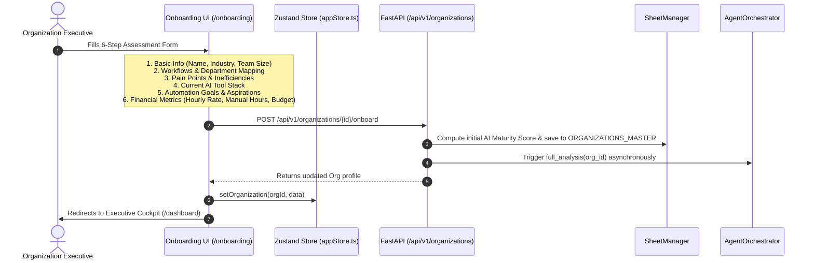
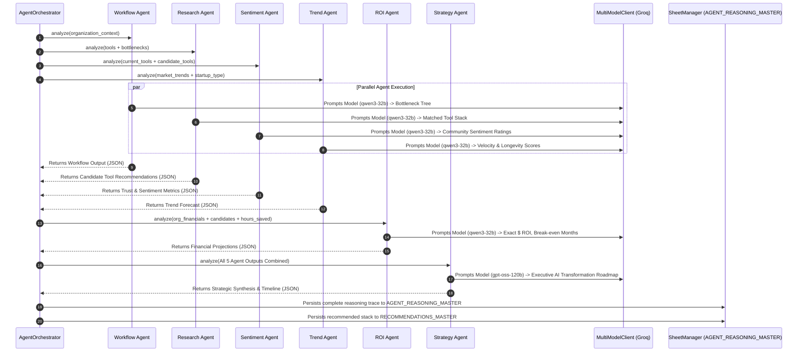
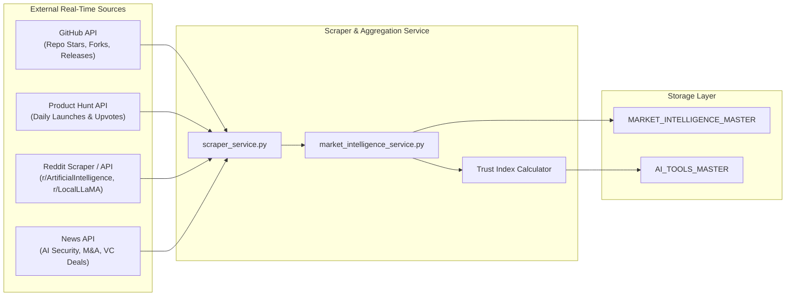
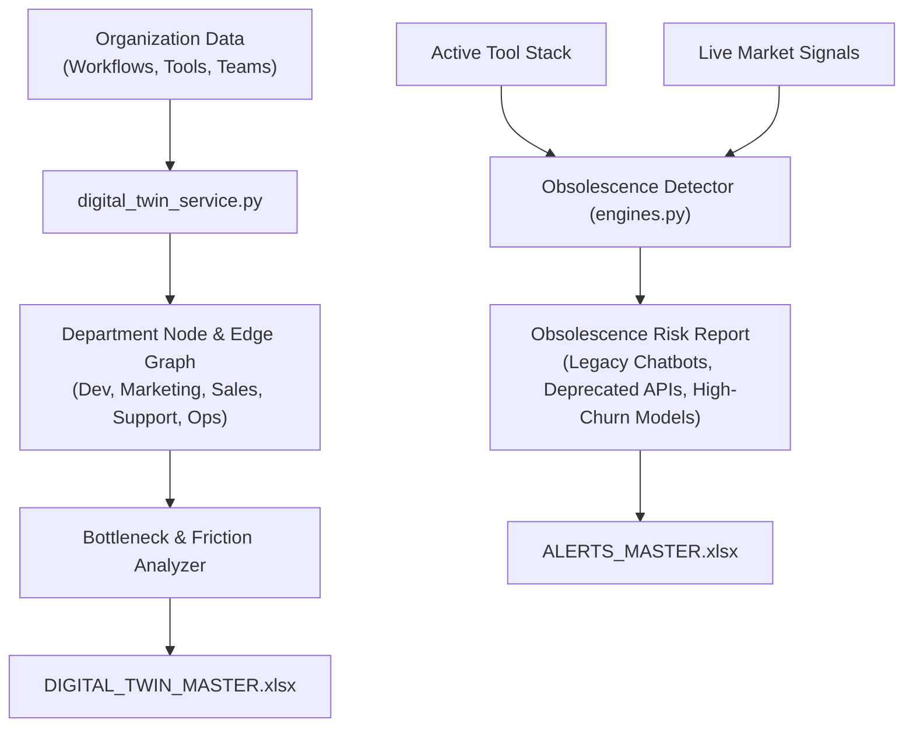
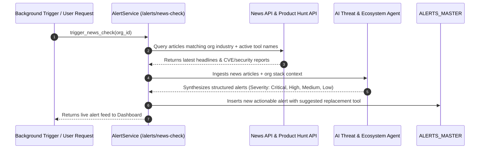
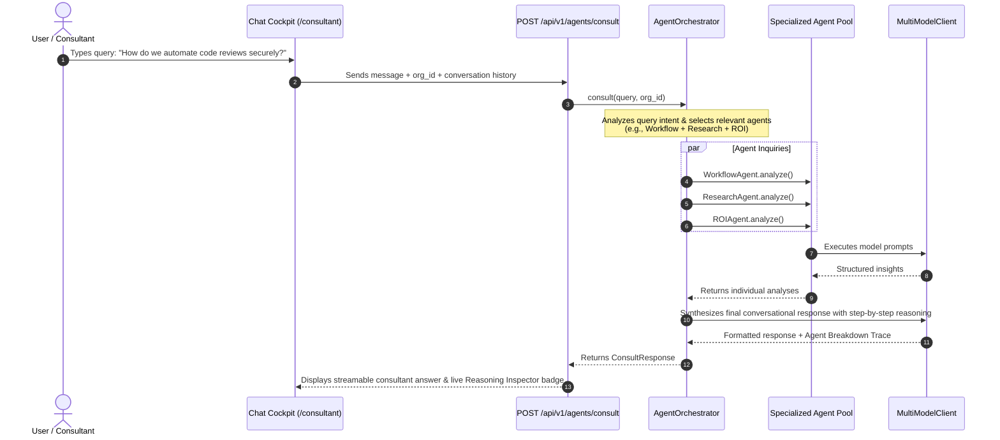
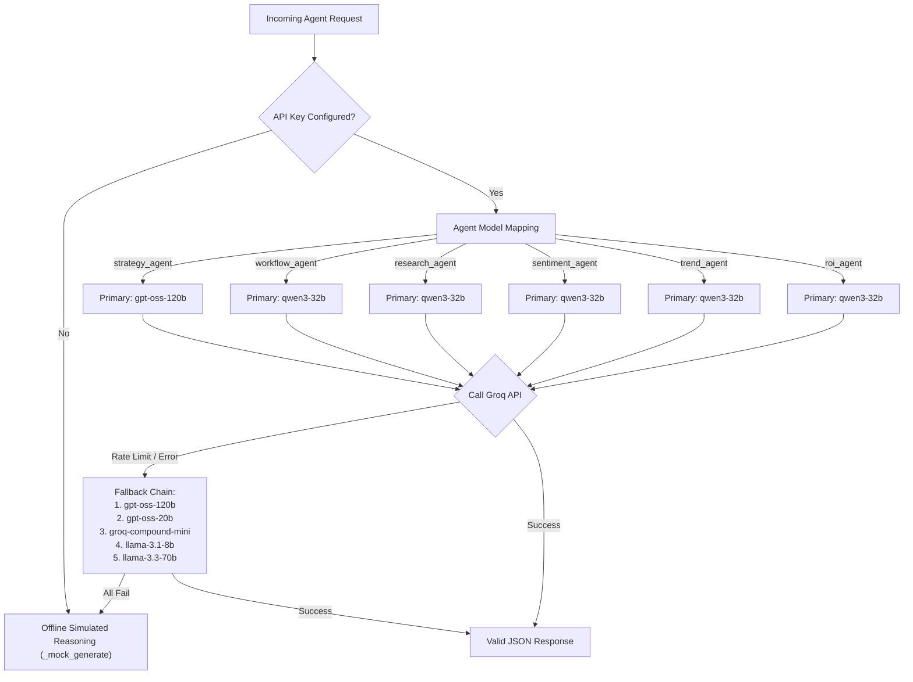

# AdaptiveAI — Master Architecture & Detailed Workflow Specification

> **Version:** 1.0.0  
> **Platform Theme:** AI-Native Operational Intelligence & Evolution Platform ("Bloomberg Terminal for AI")  
> **Repository:** `m:\Bytehearts\adaptiveai`

---

## 1. Executive Summary & Ideology

AdaptiveAI is an **enterprise-grade, adaptive AI intelligence platform** designed to solve the critical problem modern organizations face: **AI Fragmentation and Stack Obsolescence**.

Rather than serving as a static catalog or simple GPT wrapper, AdaptiveAI answers a transformative organizational question:
$$\text{"What should this organization become using AI?"}$$

The platform continuously models an organization's internal workflows, pairs them with live external AI market intelligence (Reddit sentiment, GitHub velocity, Product Hunt launches, News API signals), and runs **6 specialized reasoning agents** in an orchestrated pipeline to generate strategic AI roadmaps, calculate financial ROI, build organizational Digital Twins, and flag obsolescence risks before infrastructure falls behind.

---

## 2. Global System Architecture

```mermaid
flowchart TB
    subgraph CLIENT_TIER ["Frontend Presentation Tier (Next.js 16 + React 19 + Three.js + GSAP)"]
        UI_Home["Landing Page (/)<br/>• 3D Multi-Agent Orbit Scene<br/>• GSAP 3D Keyword Reveal<br/>• Anti-Gravity Cursor Particles"]
        UI_Onboard["Onboarding (/onboarding)<br/>• 6-Step Org AI Assessment"]
        UI_Dash["Executive Dashboard (/dashboard)<br/>• Maturity Matrix & AI Stack<br/>• Live Market & Alerts Stream"]
        UI_Consult["AI Consultant (/consultant)<br/>• Multi-Agent Live Chat & Reasoning"]
        UI_Market["Market Explorer (/market)<br/>• Trust Radar & Velocity Heatmap"]
        UI_Agents["Agent Inspector (/agents)<br/>• 6-Agent Prompt/Output Deconstruction"]
        
        ZUSTAND["Zustand State Store (appStore.ts)<br/>• Auth, Org State, Dashboard Cache"]
        API_CLIENT["Unified API Client (client.ts)<br/>• Typed HTTP Client with JWT Shield"]
    end

    subgraph API_GATEWAY ["Backend API Tier (FastAPI + Pydantic v2)"]
        FASTAPI["FastAPI Gateway (main.py)"]
        AUTH_ROUTER["Auth Routes (/api/v1/auth)"]
        ORG_ROUTER["Organization Routes (/api/v1/organizations)"]
        AGENT_ROUTER["Agent Routes (/api/v1/agents)"]
        REC_ROUTER["Recommendation Routes (/api/v1/recommendations)"]
        ALERT_ROUTER["Alert Routes (/api/v1/alerts)"]
        MKT_ROUTER["Market Routes (/api/v1/market)"]
        INTEL_ROUTER["Intelligence Routes (/api/v1/intelligence)"]
    end

    subgraph AGENT_CORE ["Multi-Agent Reasoning Core"]
        ORCHESTRATOR["Agent Orchestrator (orchestrator.py)"]
        AI_BAGGER["Multi-Model Client (ai_client.py)<br/>Primary: Groq Llama 3.3/Qwen/GPT-OSS<br/>Fallbacks + Offline Simulated Reasoning"]
        
        subgraph SPECIALIZED_AGENTS ["6 Specialized Reasoning Engines"]
            AG_WORKFLOW["Workflow Agent<br/>(Process & Bottleneck Detection)"]
            AG_RESEARCH["Research Agent<br/>(Tool Compatibility & Discovery)"]
            AG_SENTIMENT["Sentiment Agent<br/>(Community Trust & Sentiment Analysis)"]
            AG_TREND["Trend Agent<br/>(Ecosystem Velocity & Trajectory)"]
            AG_ROI["ROI Agent<br/>(Deterministic Cost/Hour Math)"]
            AG_STRATEGY["Strategy Agent<br/>(Strategic Synthesizer & Roadmap)"]
        end
    end

    subgraph SERVICES_INTELLIGENCE ["Intelligence & Scraping Engines"]
        SRV_MKT["Market Intelligence Service"]
        SRV_ALERT["Alert Service & News Scanner"]
        SRV_TWIN["Digital Twin Engine"]
        SRV_ENGINES["Intelligence Engines (Trust, Heatmap, Obsolescence)"]
        SRV_SCRAPER["Scraper Service (GitHub, ProductHunt, Reddit, News)"]
    end

    subgraph STORAGE_TIER ["Storage Abstraction Tier (Repository Pattern)"]
        SHEET_MGR["Sheet Manager Singleton (sheet_manager.py)"]
        BASE_REPO["BaseRepository Interface (base_repository.py)"]
        
        subgraph PERSISTENCE_BACKENDS ["Switchable Storage Backends"]
            BACKEND_XLS["XLSRepository (8 Master .xlsx Workbooks)"]
            BACKEND_GSHEETS["GoogleSheetsRepository (Live Cloud Sheets)"]
            BACKEND_SQL["SQLRepository (PostgreSQL / SQLite ready)"]
        end
    end

    %% Wiring connections
    CLIENT_TIER --> API_GATEWAY
    API_GATEWAY --> ORCHESTRATOR
    API_GATEWAY --> SERVICES_INTELLIGENCE
    ORCHESTRATOR --> SPECIALIZED_AGENTS
    SPECIALIZED_AGENTS --> AI_BAGGER
    SERVICES_INTELLIGENCE --> SHEET_MGR
    ORCHESTRATOR --> SHEET_MGR
    SHEET_MGR --> BASE_REPO
    BASE_REPO --> BACKEND_XLS
    BASE_REPO --> BACKEND_GSHEETS
    BASE_REPO --> BACKEND_SQL
```



---

## 3. Deep Dive: The 6 End-to-End Workflows

### Workflow 1: Organization Onboarding & AI Maturity Assessment



**Step-by-Step Logic:**
1. Executive inputs details across 6 comprehensive assessment dimensions.
2. The system computes the baseline **AI Maturity Score** ($0.0$ to $1.0$) based on team size, current tool penetration, and workflow automation readiness.
3. The record is written to `ORGANIZATIONS_MASTER.xlsx` (or Google Sheets).
4. The system immediately invokes `AgentOrchestrator.full_analysis(org_id)`.

---

### Workflow 2: Multi-Agent Collaborative Reasoning Cycle



**The 6 Agents Detailed:**
1. **Workflow Agent (`workflow_agent.py`)**: Parses department workflows, extracts friction points, and identifies automation candidates.
2. **Research Agent (`research_agent.py`)**: Queries `AI_TOOLS_MASTER` and live external APIs to find compatible, high-trust replacement tools.
3. **Sentiment Agent (`sentiment_agent.py`)**: Analyzes Reddit threads, developer sentiment, and security posture to provide trust ratings.
4. **Trend Agent (`trend_agent.py`)**: Analyzes GitHub star acceleration, Product Hunt velocity, and market momentum to ensure tools aren't declining.
5. **ROI Agent (`roi_agent.py`)**: Applies deterministic equations against `monthly_manual_hours`, `employee_hourly_rate`, and software subscription costs to forecast annual net ROI.
6. **Strategy Agent (`strategy_agent.py`)**: The master synthesizer. Ingests all 5 outputs and crafts a structured 3-12 month organizational transformation roadmap.

---

### Workflow 3: Live Market Intelligence & Continuous Web Crawling



**Composite Trust Score Formula:**
$$\text{Trust Index} = \left(\frac{\text{Sentiment} + 1}{2} \times 0.25\right) + \left(\min\left(\frac{\text{GitHub Growth}}{100}, 1.0\right) \times 0.20\right) + (\text{Security Score} \times 0.30) + (\text{Market Velocity} \times 0.25)$$

---

### Workflow 4: Digital Twin & Obsolescence Engine



**What happens inside the Digital Twin:**
1. A virtual model of the enterprise is created with nodes (departments) and edges (inter-department handoffs).
2. Each department receives an **AI Coverage Index** ($0.0 - 1.0$).
3. The **Obsolescence Detector** cross-references the organization's tools against negative sentiment spikes or stagnant GitHub repos.
4. When a tool drops below the safety threshold, an automated replacement alert is synthesized.

---

### Workflow 5: Real-Time Security & News Alert Triage



---

### Workflow 6: Interactive Multi-Agent Consultant Chat



---

## 4. Master Data Schemas (The 8 Master Tables)

The storage layer is partitioned into 8 normalized master tables managed by `SheetManager`:

| Table Name | Primary Key | Key Columns | Purpose |
|---|---|---|---|
| `USERS_MASTER` | `user_id` | `email`, `role`, `organization_id`, `hashed_password` | User identity & authentication |
| `ORGANIZATIONS_MASTER` | `organization_id` | `organization_name`, `startup_type`, `team_size`, `ai_maturity_score`, `workflows`, `current_ai_tools`, `annual_ai_budget` | Core enterprise profile & baseline assessment |
| `AI_TOOLS_MASTER` | `tool_id` | `tool_name`, `category`, `pricing`, `trust_score`, `future_proof_score`, `github_growth`, `reddit_sentiment`, `security_score` | AI tool directory with live computed ratings |
| `RECOMMENDATIONS_MASTER`| `recommendation_id`| `organization_id`, `recommended_tools`, `reasoning_summary`, `compatibility_score`, `roi_estimation` | Historical & active AI stack recommendations |
| `ALERTS_MASTER` | `alert_id` | `organization_id`, `alert_type`, `alert_message`, `replacement_tool`, `severity`, `is_dismissed` | Active security, market shift, and obsolescence alerts |
| `MARKET_INTELLIGENCE_MASTER`| `intelligence_id` | `source_type`, `source_name`, `tool_name`, `sentiment_score`, `trend_velocity`, `community_mentions` | Raw ingested market signals |
| `AGENT_REASONING_MASTER`| `reasoning_id` | `organization_id`, `query`, `workflow_agent_output`, `research_agent_output`, `sentiment_agent_output`, `roi_agent_output`, `strategy_agent_output`, `final_synthesis` | Complete audit trail of multi-agent reasoning |
| `DIGITAL_TWIN_MASTER` | `twin_id` | `organization_id`, `workflow_map`, `operational_structure`, `bottlenecks`, `ai_adoption_state`, `optimization_predictions` | Enterprise virtual graph & simulation model |

---

## 5. Multi-Model AI Routing Matrix

The backend `MultiModelClient` handles load distribution across Groq-hosted open-weights models with intelligent fallback chains:



---

## 6. Frontend Design System & Animation Engine

* **Aesthetic Theme:** Dark-mode "Bloomberg Terminal for AI" with glassmorphism and subtle glowing green/emerald accents (`#10A37F`).
* **3D Canvas (`HeroScene3D.tsx`):**
  * Built using `@react-three/fiber` & `@react-three/drei`.
  * Renders a central glowing Organizational Hub surrounded by 6 dynamic orbital tracks representing the specialized agents.
  * Interactive raycasting enables node hovering, dynamic spring camera zoom, and floating data packets traversing links.
* **GSAP 3D Text & Keyword Reveal (`page.tsx`):**
  * Avoids paid dependencies by using custom character and word splitting.
  * Integrates Framer Motion `useInView` to trigger GSAP timelines smoothly when scrolled into viewport.
  * Selected high-impact keywords receive 3D perspective rotations, scale shifts, and animated multi-stop gradient fills.
* **Anti-Gravity Cursor Particles:**
  * High-performance 2D Canvas physics simulation.
  * Repels hundreds of glowing particles away from the cursor using non-linear inverse power curves and spring restoration.

---

## 7. Developer Modification & Extension Playbook

### Adding a New Storage Backend (e.g., PostgreSQL)
1. Inherit from [`BaseRepository`](file:///m:/Bytehearts/adaptiveai/backend/app/storage/base_repository.py).
2. Implement the standard async methods: `insert`, `find_by_id`, `find_all`, `update`, `delete`, `count`, `search`, `aggregate`.
3. In [`sheet_manager.py`](file:///m:/Bytehearts/adaptiveai/backend/app/storage/sheet_manager.py), add `SQLRepository` instantiations when `STORAGE_BACKEND == "sql"`.
4. Update `.env` to set `STORAGE_BACKEND=sql`.

### Tuning AI Agent Prompts
1. Open the specific agent file in `backend/app/agents/` (e.g. [`strategy_agent.py`](file:///m:/Bytehearts/adaptiveai/backend/app/agents/strategy_agent.py)).
2. Edit `system_prompt` to modify output constraints or evaluation rubrics.
3. Edit `build_user_prompt` to customize what context is passed into the LLM.

### Running & Testing Locally

#### Start Backend:
```bash
cd m:\Bytehearts\adaptiveai\backend
python -m uvicorn app.main:app --host 0.0.0.0 --port 8000 --reload
```
* **Swagger API Documentation:** `http://localhost:8000/docs`
* **System Health Check:** `http://localhost:8000/health`

#### Start Frontend:
```bash
cd m:\Bytehearts\adaptiveai\frontend
npm run dev
```
* **Web App URL:** `http://localhost:3000`

---

*(This document is maintained as the authoritative specification of the AdaptiveAI system architecture and runtime workflows.)*
