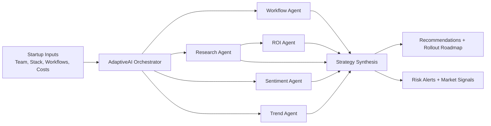

# AdaptiveAI

<p align="center">
  <strong>AI-Native Organizational Intelligence for Startups</strong><br/>
  Turn AI chaos into clear, ROI-driven execution.<br/>
  <a href="https://adaptive-startups-ai.vercel.app/"><strong>🌐 Live Application: https://adaptive-startups-ai.vercel.app/</strong></a>
</p>

<p align="center">
  
  
  
  
  
</p>

---

## What is AdaptiveAI?

**AdaptiveAI** is an AI project built for startups that need to make better AI decisions, faster.

Instead of manually evaluating dozens of tools, workflows, and vendor claims, AdaptiveAI helps teams:
- detect workflow bottlenecks,
- compare AI tooling with market intelligence,
- forecast ROI,
- and build a practical rollout roadmap.

It acts like an **AI strategy co-pilot** for founders, product leaders, and engineering teams.

---

## Why startups need this

Most startups don’t fail at using AI because of ideas — they fail because of **fragmented execution**:
- too many tools,
- unclear integration paths,
- weak measurement,
- and expensive trial-and-error.

AdaptiveAI addresses this with a structured, multi-agent intelligence layer focused on:
1. **Clarity** – what to adopt, what to skip, and why.
2. **Speed** – reduce evaluation cycles from weeks to hours.
3. **Confidence** – make decisions based on signals, not hype.
4. **Outcomes** – prioritize measurable ROI and operational impact.

---

## Core capabilities

- **Multi-Agent Reasoning Pipeline**
  - Specialized agents for workflow analysis, research, sentiment, trends, ROI, and strategy synthesis.
- **Startup Workflow Analysis**
  - Maps operational bottlenecks and identifies high-impact automation opportunities.
- **Market Intelligence Layer**
  - Uses ecosystem signals (developer and product sentiment) to evaluate tool viability.
- **ROI Modeling**
  - Estimates payback horizon, time savings, and operational efficiency gains.
- **Actionable AI Roadmaps**
  - Produces phased implementation plans for real-world startup teams.
- **Hybrid Storage Design**
  - Cloud + fallback-friendly storage patterns for reliability and continuity.

---

## High-level architecture



---

## Tech stack

### Frontend
- Next.js
- React
- TypeScript
- CSS

### Backend
- FastAPI
- Python

### Intelligence & Data
- Multi-agent orchestration
- Market signal ingestion
- Structured recommendation and analytics layer

---

## Who this project is for

- Early-stage founders choosing AI stack direction
- Product teams planning AI-enabled workflows
- Engineering leads reducing integration risk
- Startup operators optimizing team output with AI

---

## Getting started

### 1) Clone the repository
```bash
git clone https://github.com/P-mohith230/Adaptive-AI.git
cd Adaptive-AI
```

### 2) Set up backend
```bash
cd backend
python -m venv venv
# Windows:
venv\Scripts\activate
# macOS/Linux:
source venv/bin/activate

pip install -r requirements.txt
```

Create `backend/.env` with required keys (example):
```env
ENVIRONMENT=development
DEBUG=true
GROQ_API_KEY=your_key_here
JWT_SECRET_KEY=your_secret_here
```

### 3) Set up frontend
```bash
cd ../frontend
npm install
```

Create `frontend/.env.local`:
```env
NEXT_PUBLIC_API_URL=http://localhost:8000
```

### 4) Run locally
**Terminal 1 (backend):**
```bash
cd backend
python -m uvicorn app.main:app --host 127.0.0.1 --port 8000 --reload
```

**Terminal 2 (frontend):**
```bash
cd frontend
npm run dev
```

---

## Product vision

AdaptiveAI is being shaped into a **category-defining AI operating intelligence platform** for startups.

Near-term direction:
- deeper benchmarking of AI tooling quality and reliability,
- stronger cost-performance optimization recommendations,
- richer decision intelligence for multi-team AI adoption,
- and more autonomous strategy loops.

---

## Contributing

Contributions are welcome.

1. Fork the repository
2. Create a feature branch
3. Commit with clear messages
4. Open a pull request with context and screenshots (if UI changes)

---

## Branding note

This README has been intentionally rewritten to present AdaptiveAI as a **professional AI startup project** (not a hackathon-only submission) with clear market positioning and scalable product narrative.

---

## License

Please refer to the repository’s `LICENSE` file for usage terms.

---

<p align="center">
  <strong>AdaptiveAI</strong><br/>
  Build smarter. Decide faster. Scale with confidence.
</p>
